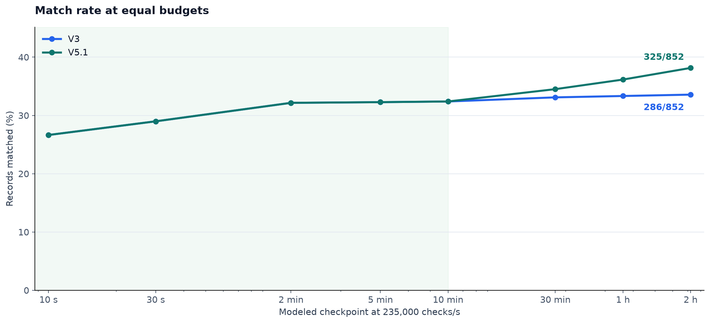
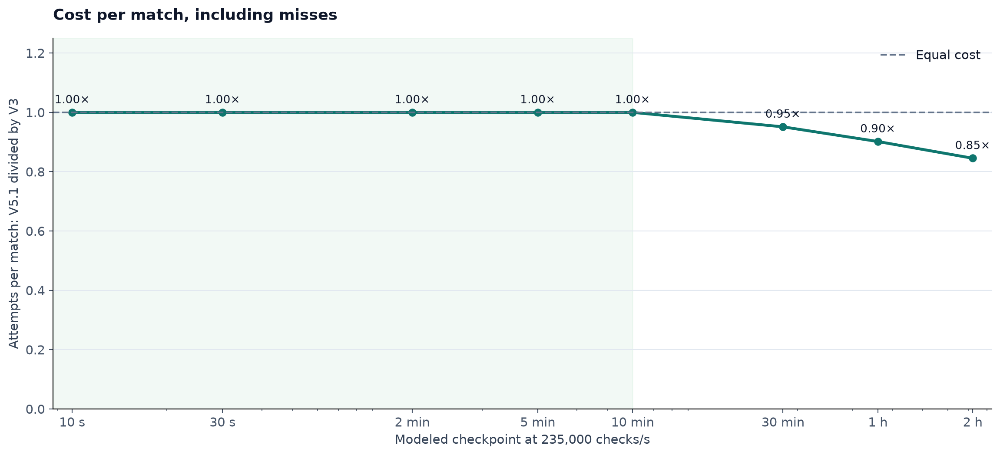
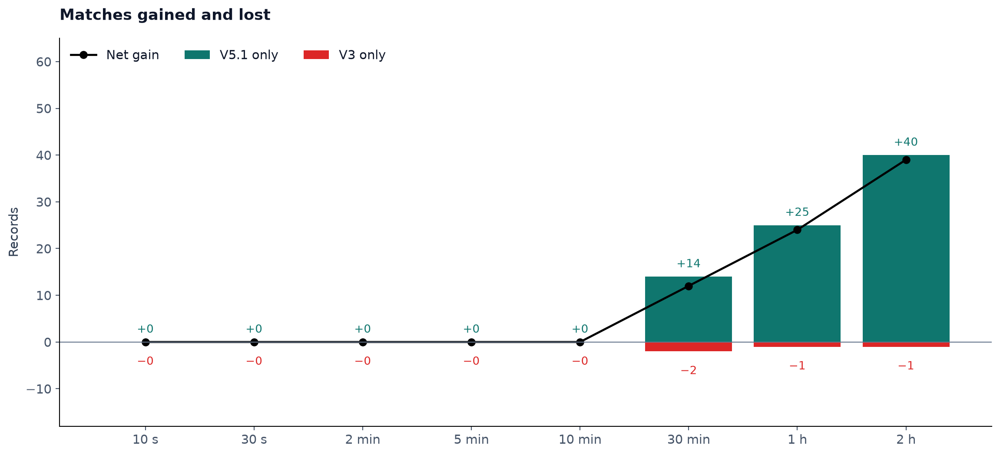
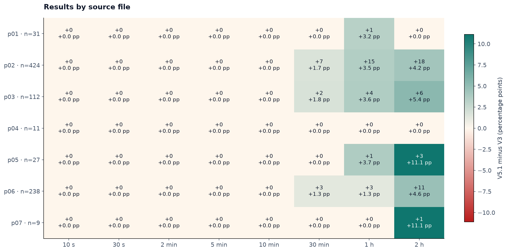
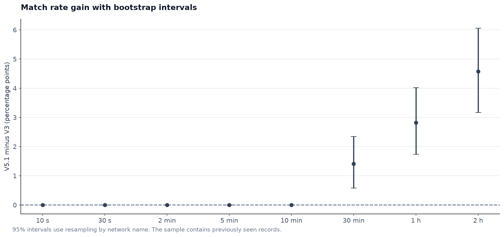

# Passweaver

An archive of offline Wi-Fi password research.

## V5.1 results

At the modeled two-hour checkpoint, V5.1 matched **325 of 852** previously
seen records. V3 matched **286**. V5.1 used **15.47% fewer attempts per match**.

<!-- markdownlint-disable MD033 -->

Gains and losses, dataset results, and stability

<!-- markdownlint-enable MD033 -->

[Full comparison](docs/v5.1/report/RESULTS.md) · [HTML report](docs/v5.1/report/report.html) · [Review and decisions](docs/v5.1/README.md)

## Revisions and tests

[V3](final-algorithm/README.md) · [V4.1](hybrid-v4/README.md) · [V5](hybrid-v5/README.md) · [V5.1](hybrid-v5.1/README.md)

Run `python3 run_tests.py` from the repository root with Python 3.9 or later.
See the agent guide for [documentation checks](AGENTS.md#checks) and
[commit signing](AGENTS.md#signed-commits).

## Provenance

Verify the [signed V5.1 source import](https://github.com/pavelzaitsau/passweaver/tree/086da079bb278101cc9aaa90f91a8804b9cf560b)
and [report files](docs/v5.1) with the [snapshot manifest](SNAPSHOT-MANIFEST.json)
and [transfer verification record](V5-TRANSFER-VERIFICATION.json).
The archive excludes private inputs, individual outcomes, captures, and keys.

## Disclaimer

To the maximum extent permitted by law, the author provides Passweaver "as is",
without any warranty or condition of any kind. The author and the contributors
accept no liability under any legal theory, including contract, tort, and
negligence. The exclusion covers any damage, loss, legal consequence, or other
harm from the software, its documentation, or any use of them.

Anyone who runs, modifies, or distributes Passweaver does so at their own risk
and is responsible for every run: the captures and records they test candidates
against, the legal basis for that test, the handling of any captured data, and
compliance with the law. Nothing in this repository authorizes testing any
network or any capture you do not own or have written permission to test, and
nothing in it is legal advice. Many jurisdictions restrict intercepting wireless
traffic and recovering passwords, and doing so without authorization can be a
crime.

## License

Passweaver is licensed under the
[PolyForm Noncommercial License 1.0.0](LICENSE). Commercial use is not
permitted. The license permits more than the intended use;
[acceptable use](docs/acceptable-use.md) states the intended use and its limits.
The components that [NOTICE](NOTICE) lists keep their own licenses: PRINCE (MIT),
the Copydesk skills (MIT-0), the FrequencyWords wordlists (CC BY-SA 4.0), and the
public password and frequency wordlists (MIT). One English frequency wordlist has
unconfirmed provenance, which [NOTICE](NOTICE) tracks. A contribution is accepted
only under the terms in [CONTRIBUTING](CONTRIBUTING.md).
