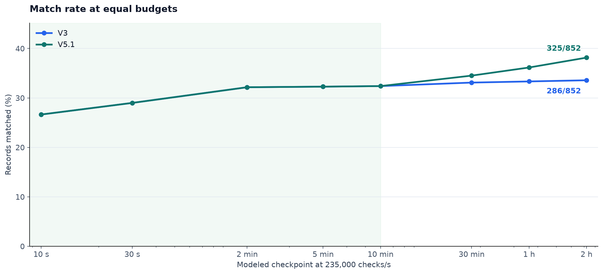
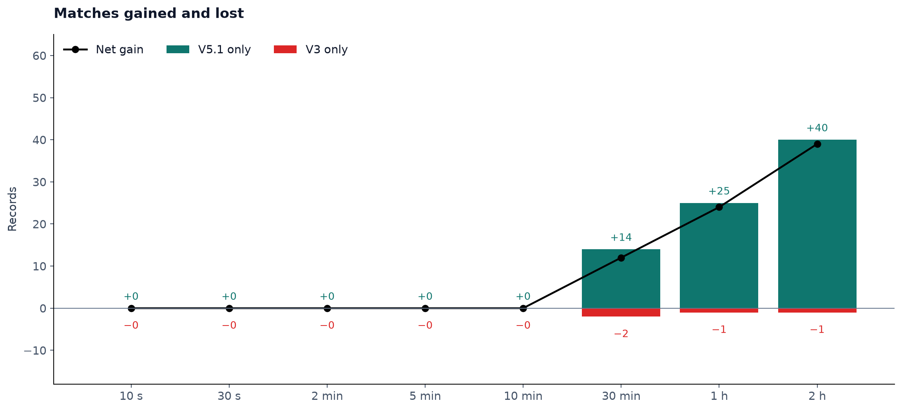
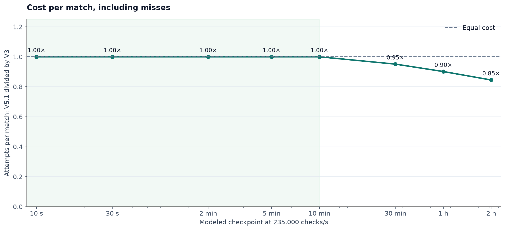
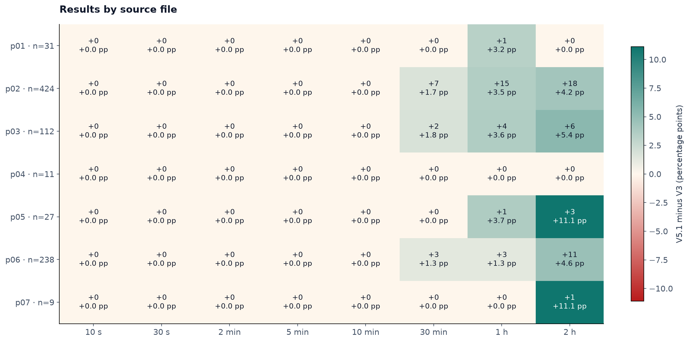
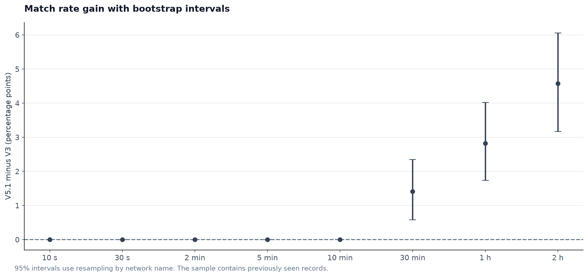

# V5.1 comparison

At the two-hour checkpoint, V5.1 matched 325 of 852 records. V3 matched
286. V5.1 gained 40 matches and lost one, for a net gain of 39.

## Checkpoints

Both versions used the same budgets. Time is modeled at 235,000 checks
per second. The study used 852 previously seen records across 814 network
names. The records contained network names only.

| Checkpoint | Attempts in millions | V3 | V5.1 | Gained | Lost | Net |
| --- | --- | --- | --- | --- | --- | --- |
| 10 s | 2.35 | 227 | 227 | 0 | 0 | 0 |
| 30 s | 7.05 | 247 | 247 | 0 | 0 | 0 |
| 2 min | 28.20 | 274 | 274 | 0 | 0 | 0 |
| 5 min | 70.50 | 275 | 275 | 0 | 0 | 0 |
| 10 min | 141.00 | 276 | 276 | 0 | 0 | 0 |
| 30 min | 423.00 | 282 | 294 | 14 | 2 | +12 |
| 1 h | 846.00 | 284 | 308 | 25 | 1 | +24 |
| 2 h | 1,692.00 | 286 | 325 | 40 | 1 | +39 |

## Cost per match

At two hours, V5.1 used 15.47% fewer attempts per match than V3. The
metric divides total attempts by matches and includes attempts spent on
records with no match. It excludes preparation and generation time.

## PRINCE control

The control gave the PRINCE budget share back to V3. At two hours, the
control matched 307 records and the main profile matched 325. The net
gain of 18 measures the effect of the budget policy.

| Checkpoint | Without PRINCE | With PRINCE | Gained | Lost | Net |
| --- | --- | --- | --- | --- | --- |
| 10 s | 227 | 227 | 0 | 0 | 0 |
| 30 s | 247 | 247 | 0 | 0 | 0 |
| 2 min | 274 | 274 | 0 | 0 | 0 |
| 5 min | 275 | 275 | 0 | 0 | 0 |
| 10 min | 276 | 276 | 0 | 0 | 0 |
| 30 min | 288 | 294 | 6 | 0 | +6 |
| 1 h | 298 | 308 | 10 | 0 | +10 |
| 2 h | 307 | 325 | 19 | 1 | +18 |

## Limits

The two-hour gain averaged 5.2 percentage points with equal weight per
source file. Leaving out one file at a time gave gains from 4.4 to 4.9
points. The paired 95% bootstrap interval was 3.2 to 6.1 points, based on
5,000 resamples grouped by network name.

The records helped shape earlier experiments. The study measures results
on those records. The data cannot establish performance on new networks
or the effect of extra context.

## Data and review

The [metrics JSON](metrics.json) contains the breakdown for all seven
source files. The [checkpoints CSV](checkpoints.csv) and
[PRINCE control CSV](prince-control.csv) contain the aggregate tables.
The [final review](FINAL-REVIEW.md) records the independent checks.
